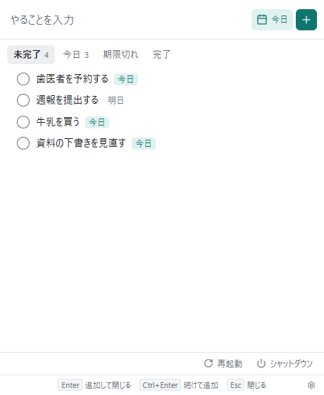

# Quick Todo

ショートカットキーで呼び出す、Windows 用の軽量な todo アプリです。インストールは不要で、exe 1 つで動きます。

## 使い始める

1. [リリースのページ](https://github.com/s0911515/quick-todo/releases/latest) から `QuickTodo-vX.Y.Z-win-x64.zip` をダウンロードします。
2. zip の中の `quick-todo.exe` を、好きなフォルダに置いて起動します。

初回の起動で、Windows の起動時に自動で常駐するように設定します（設定から切れます）。

動かすには Microsoft Edge WebView2 ランタイムが必要です。Windows 11 には標準で入っています。

実行ファイルには署名がないため、初回の起動で SmartScreen の警告が出ることがあります。

## 使い方

| 操作 | キー |
|---|---|
| 呼び出す / 隠す | `Ctrl+Alt+T` |
| 追加して閉じる | `Enter` |
| 追加して入力を続ける | `Ctrl+Enter` |
| 閉じる | `Esc`（別の場所をクリックしても閉じます） |

- 編集はタイトルのダブルクリック、並べ替えは行のドラッグで行います。
- 期限を指定せずに追加すると、期限は今日になります。ほかの日や「期限なし」は、カレンダーのアイコンから選びます。「今日」「期限切れ」のタブで絞り込めます。
- 完了や削除のあと、数秒間は「元に戻す」が使えます。
- 設定は右下の歯車から開きます。終了はタスクトレイのアイコンの右クリックから行います。

## PC の再起動とシャットダウン

右下の「再起動」から PC を再起動できます。シャットダウンのボタンは、設定の「シャットダウンのボタンも表示する」をオンにすると出ます（シャットダウンを禁止している PC があるため、既定では出しません）。

実行の前に確認の画面が出ます。今日が期限のタスクや期限切れのタスクがあれば、その一覧も表示します。保存していない作業があるアプリは強制的には閉じないので、Windows の画面に従ってください。

この確認が出るのは、このボタンを使ったときだけです。スタートメニューなどから再起動したときは出ません。

## 更新

新しい版を、起動の少しあとと、その後 1 日ごとに確認します（設定で切れます）。確認に失敗したときは、1 時間のあいだ 5 分ごとにやり直します。

見つかると Windows の通知でお知らせします。通知をクリックするか呼び出すと画面の上に案内が出ているので、「更新する」を押すと置き換えて起動し直します。Windows の「応答不可」がオンのときはポップアップにならず、通知センターに入ります。

通信は Windows の機能（WinINet）で行うので、ブラウザと同じプロキシの設定で動きます。ログオン情報で通れないプロキシでは、手動で確認したときや更新するときに Windows の入力画面が出ます。

## データの場所

`%APPDATA%\com.s0911515.quicktodo` に保存します。

| ファイル | 内容 |
|---|---|
| `todos.json` | todo の一覧 |
| `todos.bak.json` | 直前の状態のバックアップ |
| `settings.json` | 設定 |

データは PC の外へ送りません。通信するのは更新の確認とダウンロード（GitHub）だけです。

## アンインストール

1. タスクトレイのアイコンを右クリックし、「Windows 起動時に自動で開始」のチェックを外して「終了」を選びます。
2. `quick-todo.exe` を削除します。
3. データも消す場合は、上のフォルダと `%LOCALAPPDATA%\com.s0911515.quicktodo` を削除します。

## ライセンス

無償で利用できます。再配布はできません。詳しくは [LICENSE.txt](LICENSE.txt) を見てください。
